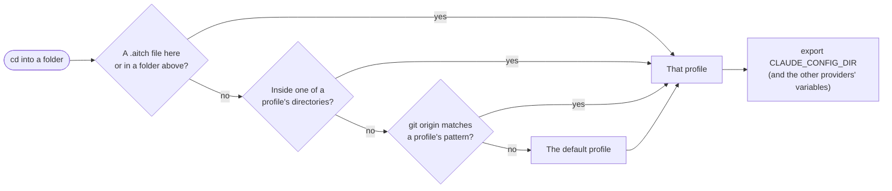

# aitch

Each project folder uses its own AI account. `cd` into a work repo and Claude Code runs on your work login;
`cd` into a side project and it runs on your personal one, with nothing to type in between.

[](https://github.com/orzazade/aitch/actions/workflows/ci.yml)
[](https://github.com/orzazade/aitch/releases/latest)
[](LICENSE)

Claude Code keeps its login, settings, `CLAUDE.md` and MCP servers in one config folder, and it reads the
folder's path from `CLAUDE_CONFIG_DIR`. With two accounts you have two folders. Without aitch, you set that
variable by hand every time and sometimes forget:

```bash
cd ~/work/acme/api
CLAUDE_CONFIG_DIR=~/.claude-work claude   # forget this once and the client's code goes through your personal account
```

aitch adds a shell hook. Every time you change folder, it sets the variable for that folder:

```bash
cd ~/work/acme/api && claude   # work account
cd ~/code/blog && claude       # personal account
```



## Contents

- [Install](#install)
- [Quick start](#quick-start)
- [Config](#config)
- [Commands](#commands)
- [How a folder picks a profile](#how-a-folder-picks-a-profile)
- [Share a profile through the repo](#share-a-profile-through-the-repo)
- [Routing by quota (Claude Code)](#routing-by-quota-claude-code)
- [FAQ and troubleshooting](#faq-and-troubleshooting)
- [Contributing](#contributing)

## Install

aitch runs on macOS and Linux, with zsh or bash. Git remote matching needs `git` on your `PATH`.

### Release binary

Builds for Apple silicon and Intel Macs and for x86_64 and arm64 Linux are on the
[releases page](https://github.com/orzazade/aitch/releases/latest). Each archive holds one file, `aitch`:

```bash
# Pick your target: aarch64-apple-darwin, x86_64-apple-darwin,
# x86_64-unknown-linux-gnu or aarch64-unknown-linux-gnu
curl -L https://github.com/orzazade/aitch/releases/latest/download/aitch-aarch64-apple-darwin.tar.gz | tar xz
mv aitch ~/.local/bin/   # or any folder on your PATH
```

### With cargo

aitch is not on crates.io. A different crate already has the name there, so `cargo install aitch` installs the
wrong program. Install from the repo:

```bash
cargo install --git https://github.com/orzazade/aitch
```

### From source

```bash
git clone https://github.com/orzazade/aitch
cd aitch
cargo build --release   # the binary is target/release/aitch
```

## Quick start

Say your work repos live under `~/work/acme`, everything else is personal, and you have one Claude Code config
folder for each account.

```bash
aitch init
aitch add work --dir ~/work/acme --claude ~/.claude-work
aitch add personal --dir ~/code --claude ~/.claude-personal
aitch default personal                      # used in any folder no rule matches

echo 'eval "$(aitch hook zsh)"' >> ~/.zshrc  # bash: echo 'eval "$(aitch hook bash)"' >> ~/.bashrc
exec zsh
```

Check what a folder gets:

```console
$ cd ~/work/acme/api && aitch which
Directory: /home/you/work/acme/api
Profile: work (directory match: /home/you/work/acme)

Providers:
  CLAUDE_CONFIG_DIR = /home/you/.claude-work
```

The first time you run `claude` under each profile, use `/login` to sign in with that profile's account. After
that, the folder decides which account you get.

## Config

`aitch add` writes `~/.aitch/config.yaml`. You can also edit the file by hand; a new shell picks up the change.

```yaml
default: personal

profiles:
  work:
    providers:
      claude: ~/.claude-work
    directories:
      - ~/work/acme
    git_remotes:
      - "github.com/acme/*"     # any clone of an acme repo, wherever it is on disk

  personal:
    providers:
      claude: ~/.claude-personal
    directories:
      - ~/code
```

| Field | Meaning |
|-------|---------|
| `default` | The profile used where nothing else matches. |
| `providers` | The config folder for each tool. An empty value (`codex: ""`) unsets that tool's variable. |
| `directories` | The folders that belong to the profile, and everything inside them. |
| `git_remotes` | Patterns matched against the repo's `origin` URL. `github.com/acme/*` matches HTTPS and SSH clones. |
| `route` | Optional. Start Claude Code on a second account while it has quota; see [below](#routing-by-quota-claude-code). |

Each provider sets one variable, the one the tool itself reads:

| Key | Tool | Variable aitch exports | The folder you give it |
|-----|------|------------------------|------------------------|
| `claude` | Claude Code | `CLAUDE_CONFIG_DIR` | The config folder, like `~/.claude-work`. |
| `codex` | OpenAI Codex | [`CODEX_HOME`](https://developers.openai.com/codex/config-advanced) | The Codex home, like `~/.codex-work`. |
| `gemini` | Gemini CLI | [`GEMINI_CLI_HOME`](https://github.com/google-gemini/gemini-cli/blob/main/docs/reference/configuration.md) | The folder Gemini CLI makes its `.gemini` folder in, like `~/gemini-work`. A path that ends in `.gemini` is exported as the folder above it. |

## Commands

| Command | What it does |
|---------|--------------|
| `aitch init` | Create `~/.aitch/config.yaml`. |
| `aitch add <name> [--dir D] [--git PATTERN] [--claude D] [--codex D] [--gemini D]` | Create a profile or add to one. Run it again to add more folders or patterns. |
| `aitch default <name>` | Set the profile for folders that match nothing. |
| `aitch list` | Show every profile with its folders, patterns and variables. |
| `aitch remove <name>` | Delete a profile. |
| `aitch status` | Show the profile for the current folder. |
| `aitch which` | Show the profile for the current folder and the rule that picked it. |
| `aitch hook zsh` / `aitch hook bash` | Print the shell hook. Put it in `~/.zshrc` or `~/.bashrc` with `eval`. |
| `aitch link <from> <to>` | Make `<to>` a Claude Code config folder that shares `<from>`'s rules by symlink. |
| `aitch launch claude [--primary <dir>] [-- args]` | Start Claude Code with the folder a route picks, as `claude` does after the hook. `--primary` names the primary folder for this launch. |
| `aitch doctor` | Check every Claude Code config folder: login, MCP servers and answers shared from its source, MCP sign-ins. |

Every command takes `--help`.

## How a folder picks a profile

aitch checks four rules in this order and uses the first that matches:

1. A `.aitch` file in the folder or any folder above it, holding a profile name. A file that names a profile you
   don't have is skipped, and the search goes on to the folders above.
2. A directory match: the folder is one of a profile's `directories` or inside one. Matching ignores case and
   stops at folder names, so `~/work/acme` does not match `~/work/acme-old`.
3. A git remote match: the repo's `origin` URL contains the pattern. `github.com/acme/*` and
   `github.com:acme/*` both match `https://github.com/acme/tool` and `git@github.com:acme/tool.git`.
4. The default profile.

`aitch which` tells you which rule won:

```console
$ cd ~/oss/tool && aitch which
Directory: /home/you/oss/tool
Profile: work (git remote: git@github.com:acme/tool.git matched github.com/acme/*)

Providers:
  CLAUDE_CONFIG_DIR = ~/.claude-work
```

aitch compiles the config into a small shell script, `~/.aitch/cache`, and the hook sources that script when the
folder changes (zsh `chpwd`, bash `PROMPT_COMMAND`), so a `cd` doesn't run aitch itself. The script is rebuilt by
`init`, `add`, `default` and `remove`, and by `aitch hook` in every new shell. On `cd` the hook only sets
variables. With a [route](#routing-by-quota-claude-code) in the config, it also puts a `claude` shim first on `PATH`.

## Share a profile through the repo

Commit a `.aitch` file and everyone on the team who has a profile with that name gets it in this repo:

```bash
echo work > .aitch
git add .aitch
git commit -m "chore: add aitch profile"
```

Each person's `work` profile points at their own config folder, so the file holds no paths or accounts.

## Routing by quota (Claude Code)

This is for people with two Claude accounts for the same work, for example a team seat and a personal plan. A
profile can start Claude Code on the second account while that account has quota left, and on the profile's own
account when it doesn't. aitch decides once, when `claude` starts. It never switches a session that is already
running.

```yaml
profiles:
  work:
    providers:
      claude: ~/.claude-work         # the fallback folder: the profile's own account
    directories:
      - ~/work/acme
    route:
      claude:
        primary: ~/.claude-alt       # used while the quota command says "room"
        quota: ~/bin/my-quota        # any program that follows the contract below
        primary_org: <org uuid>      # optional: the login the primary folder must hold
        fallback_org: <org uuid>     # optional: the login the fallback folder must hold
```

Set up the second folder once:

```bash
aitch link ~/.claude-work ~/.claude-alt         # share the fallback folder's rules
CLAUDE_CONFIG_DIR=~/.claude-alt command claude  # then /login with the second account
```

`aitch link` creates the folder and symlinks each of these that exists in the fallback folder: `CLAUDE.md`,
`settings.json`, `agents`, `skills`, `commands`, `hooks`, `output-styles`, `plugins` and `projects`. The login
(`.claude.json` and the keychain entry) stays separate. It never replaces a file that isn't already the right link.

### One config for every linked folder

`.claude.json` holds the login, so it cannot be a link. aitch copies into each linked folder's `.claude.json` what
the source folder sets for all of them, when you run `aitch link` and on every launch through aitch:

- the MCP servers, user and local scope: the linked folder gets exactly the source's list;
- each yes to a start-up question, per project: folder trust, CLAUDE.md imports from outside the folder, approved
  `.mcp.json` servers. A no is never copied.

Nothing else changes; the login fields are never touched. A missing `.claude.json` is created with mode 0600. Before
each write the old file is saved in `~/.aitch/backups/` (mode 0600, the last 10 per folder). Each launch that
changes something prints a line such as `aitch: ~/.claude-alt synced from ~/.claude-work: MCP servers +db`. `claude
mcp …` on a linked folder runs on the source, where the servers are kept.

MCP sign-ins (OAuth) are not copied: Claude Code keeps them in the folder's keychain item, next to its login. Sign
in once per folder with `/mcp`. `aitch doctor` lists, per folder, the login, whether its servers and answers match
the source, and each MCP server that still needs a sign-in. It exits 1 when it finds a problem and prints no token.

With a route in the config, the hook links `~/.aitch/bin/claude` to aitch and puts `~/.aitch/bin` first on `PATH`,
so `type claude` shows `~/.aitch/bin/claude`. When aitch runs as `claude`, it picks the folder and then starts the
next `claude` on `PATH`. This also works in terminals that set up their own `claude` shell function, such as cmux:
their wrapper finds the shim on `PATH`. `aitch launch claude -- <args>` does the same thing by name. Each launch
prints one line to stderr with the folder it picked and why:

```text
aitch: work → primary (~/.claude-alt): 7d 43%, 5h 9%
aitch: work → fallback (~/.claude-work): quota full: 7d 100%
aitch: work → fallback (~/.claude-work): QUOTA UNKNOWN: exit 4: no sample. Not using the primary dir.
```

aitch only uses the primary folder on a clear "room". It uses the fallback folder when the quota command fails, is
missing, takes more than 3 seconds or prints something unexpected. It also falls back when a link in the primary
folder was replaced, or the primary folder's login is not `primary_org`. If the fallback folder's login is not
`fallback_org`, aitch refuses to start Claude Code. The org uuid is `oauthAccount.organizationUuid` in that folder's
`.claude.json`.

Claude Code keeps MCP servers next to the login, so the primary folder has none of its own. On a primary launch,
aitch passes the fallback folder's servers (user scope, plus local scope for the launch folder's git repo) with
`--mcp-config`, from a file in `~/.aitch/run/` with mode 0600. It also sets `ENABLE_CLAUDEAI_MCP_SERVERS=false`
to keep the second account's claude.ai connectors out. Because primary launches read servers from the fallback
folder, `claude mcp …` always runs there. Put `mcp` first, before any flag.

With more than one second account, `aitch launch claude --primary <dir> -- <args>` uses `<dir>` as the primary
folder for this one launch. Link it first (`aitch link <fallback> <dir>`) and sign in there. The links check, the
quota command and the fallback rules stay the same; `primary_org` is not checked, since the caller picked the
account, but `<dir>` must be a full path (or start with `~/`) and be signed in. The quota command must read
`AITCH_PRIMARY`, or its answer is about some other account. A config that does not load refuses `--primary`.

A profile with no route takes `--primary` too: `<dir>` must be the profile's own Claude folder or a folder linked
to it, and signed in. aitch starts it with no quota command. The profile's own default folder (`claude: ''`) starts
with `CLAUDE_CONFIG_DIR` unset, as the hook does: Claude Code names a folder's keychain login after that variable,
so setting it to `~/.claude` would look for another login.

Folder trust carries over too. If the other folder of the route already trusts the launch folder (or one above
it), aitch marks it trusted in the folder it picked, so Claude Code doesn't ask again.

A program that starts Claude Code by its full path (not `claude` from `PATH`), or that runs without the hook's
`PATH`, gets the fallback folder from `CLAUDE_CONFIG_DIR`. If no other `claude` is on `PATH`, the shim says so and
exits with code 127.

### Quota command contract

Any program can be the quota command. aitch runs it without a shell: it splits the string on spaces and expands
`~` in the program path only, so give any file arguments as full paths. It reads one JSON line from stdout:

```json
{"verdict": "room", "reason": "7d 43%, 5h 9%"}
```

| Exit code | `verdict` | aitch uses |
|-----------|-----------|------------|
| 0 | `room` | the primary folder |
| 3 | `full` | the fallback folder |
| 4 | `unknown` | the fallback folder, with a loud warning |
| anything else, or no valid JSON | — | the fallback folder, with a loud warning and the first stderr line |

aitch sets `AITCH_PRIMARY` to the primary folder it asks about (the route's, or the one `--primary` named), so one
command can answer for several accounts.

aitch prints `reason` as is, so keep it to one short line. It ignores any other fields.

## FAQ and troubleshooting

### `aitch which` is right but `echo $CLAUDE_CONFIG_DIR` is not

The hook isn't loaded in this shell. Check that `eval "$(aitch hook zsh)"` (or `bash`) is in your rc file, then
open a new shell.

### I edited `config.yaml` and nothing changed

The hook reads a compiled copy. Open a new shell, or run any `aitch` command that saves the config (`add`,
`default`, `remove`) to rebuild it.

### I left a work folder and still have the work account

In a folder that no rule matches, the hook leaves the variables as they were. Set a default profile with
`aitch default <name>`.

### A variable keeps its work value in personal folders

The personal profile doesn't set that provider, so the old value stays. Give it a folder, or an empty value to
unset it: `aitch add personal --codex ""`.

### Two profiles list folders inside each other

Directory matches are checked one profile at a time, in name order, and the first match wins, even when another
profile has a longer path that fits. Put a `.aitch` file in the inner folder, since that rule is checked first.

### Does it work with fish?

No. `aitch hook` supports zsh and bash.

## Contributing

Issues and pull requests are welcome. Before you open a PR, run what CI runs:

```bash
cargo test --all
cargo clippy -- -D warnings
cargo fmt -- --check
```

The hook tests run the generated shell code in both bash and zsh, so you need both installed. Changes are listed
in [CHANGELOG.md](CHANGELOG.md).

## License

[MIT](LICENSE)
